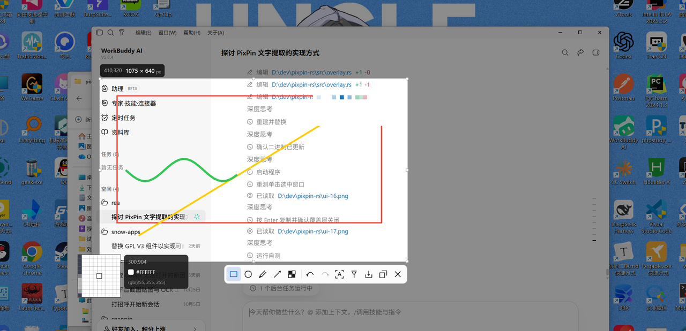
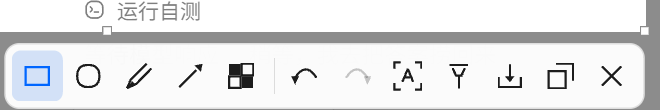
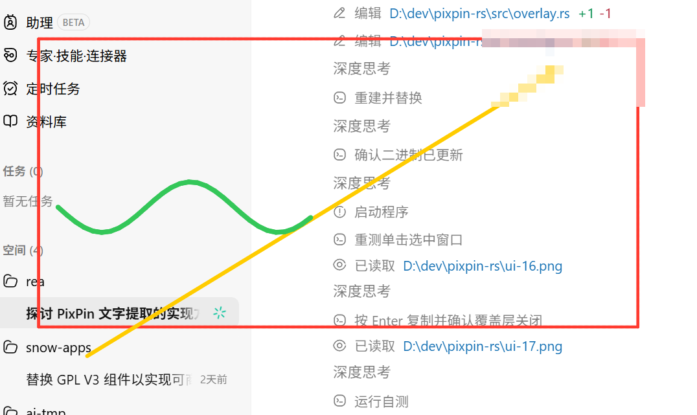
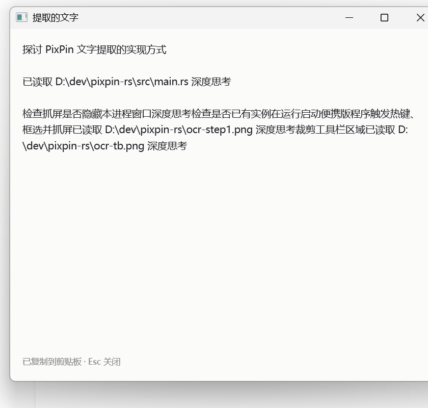
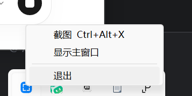
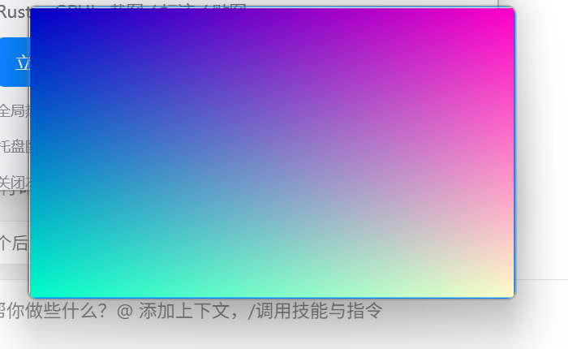

# PixPin-RS

> 用 **Rust + GPUI** 复刻 PixPin 的截图工作流：全局热键 → 冻结屏幕 → 框选 → 标注 → 复制 / 保存 / 贴图 / 取字。
>
> Windows 桌面工具，约 8300 行 Rust，32 个源文件，单 crate 五层结构。

<p align="center">
  
</p>

---

## 这个项目没有一行是人写的

**从 Win32 抓屏到 GPUI 界面，从 OCR 推理到 GitHub Actions 脚本，全部代码由 AI 生成，人类没有手写过任何一行。**

工作方式是：人提需求、运行看效果、指出哪里不对；AI 读代码、改代码、编译、跑自测、打包。整个项目是在对话里一轮轮长出来的——包括那些反直觉的细节，比如「GPUI 的纹理是 BGRA 不是 RGBA」「`keybd_event` 注入的按键触发不了 `RegisterHotKey`」「窗口刚创建时抢前台一定失败」，都是 AI 自己踩坑、自己定位、自己写进注释的（原始记录见 [docs/NOTES.md](docs/NOTES.md)）。

人类在这个项目里做的事情是：决定做什么、判断好不好用、验证能不能跑。**写代码这件事完全交给了 AI。**

---

## 软件截图

**截图与标注**（冻结屏幕 + 框选 + 八向手柄 + 放大镜取色 + 矢量工具栏）



**工具栏**（左半标注工具，右半动作，中间分隔线；图标全是 `PathBuilder` 现画的矢量图形）



**标注导出效果**（矩形 / 箭头 / 画笔 / 马赛克，软件栅格化，画笔带抗锯齿）



**取字结果窗口**（拖拽选择 / 双击选词 / 右键菜单）



**托盘菜单**



**贴图窗口**（钉在屏幕上，蓝框是窗口边界；这张是自测用的渐变色块，专门用来验证置顶、拖动和滚轮缩放）



---

## 功能说明

### 截图

| 能力 | 说明 |
|---|---|
| 全局热键 | `Ctrl+Alt+X`，独占注册；被占用时托盘气泡 + 设置页红字提示，并保留「立即截图」按钮兜底 |
| 冻结屏幕 | GDI BitBlt + `CAPTUREBLT`，抓光标所在显示器；抓屏前隐藏本进程窗口并 `DwmFlush`，不会把自己截进去 |
| 框选 | 拖出新选区、八向手柄改尺寸、按住内部整体平移；反向拖拽自动翻转 |
| 窗口吸附 | 没有选区时悬停高亮光标下的窗口，单击直接选中整窗 |
| 尺寸徽标 | 选区左上角显示 `x,y  宽 × 高 px`，屏幕物理像素口径 |
| 放大镜 / 取色 | 光标旁 11×11 像素网格放大 9 倍，实时坐标 + `#RRGGBB` + `rgb()` |
| 高 DPI | 按 `GetDpiForMonitor` 换算逻辑 / 物理像素，150% 缩放下手柄和工具栏位置仍然准确 |

### 标注

| 工具 | 说明 |
|---|---|
| 矩形 / 椭圆 / 箭头 | 实时矢量预览，导出时软件栅格化 |
| 画笔 | Chaikin 平滑 + 覆盖率抗锯齿，斜线无台阶、重叠处不叠色 |
| 文本 | 点击定位后键入，`Enter` 落定 / `Esc` 取消；英文直接敲，中文 `Ctrl+V` 粘贴（GPUI 0.2.2 无 IME）；字号 12–64 |
| 马赛克 | 框选 / 涂抹两种模式，块大小 4–40 可调；真块状化，不是模糊 |
| 橡皮擦 | 任意工具下**右键拖过即擦除**（原地右键仍是取消截图）；悬停高亮将被擦除的形状 |
| 颜色 / 线宽 | `⌄` 菜单：HSV 取色盘（饱和度-明度面板 + 色相条，拖动连续取色，实时 `#RRGGBB`）+ 线宽滑杆 1–20 |
| 撤销 / 重做 | 快照式，橡皮擦擦掉的也能找回；`Ctrl+Z` / `Ctrl+Shift+Z` / `Ctrl+Y` |

### 输出

| 能力 | 说明 |
|---|---|
| 复制 | `Enter` / `Ctrl+C` / 工具栏「复制」，走剪贴板位图 |
| 保存 | `Ctrl+S`，默认 `%USERPROFILE%\Pictures\PixPinRS\`；exe 旁有 `portable.txt` 时改存 `screenshots\` |
| 贴图 | 置顶无边框窗口：左键拖动、**滚轮以光标为锚点缩放 10%–400%**、双击取消、右键菜单 |
| 贴图二次编辑 | 右键「编辑标注」把贴图送回覆盖层继续标注 / 打码 / 取字，弄完再贴图或复制保存；按 `Esc` 取消则原贴图原样回来 |
| 贴图取字 | 右键「提取文字」直接对整张图 OCR，不用再框选 |
| 取字（本地 OCR） | DBNet 检测 + PP-OCRv5 识别，全离线 CPU，约 0.2 秒（900×520）；结果窗口支持拖选 / 双击选词 / 三击选行 / 右键菜单 / 自动复制 |
| 设置窗口 | 开机自启（写 `HKCU\...\Run`）、OCR 自动复制、结果字号、保存目录；JSON 持久化，便携模式跟随 exe |

### 托盘

左键截图、右键菜单（截图 / 设置… / 退出）。程序没有主窗口，托盘 + 热键是唯二入口，关掉任何窗口都不会退出进程。

---

## 启动方法

### 一、直接用便携版（推荐）

1. 到 [Releases](../../releases) 下载 `PixPin-RS-portable-vX.Y.Z.zip`（或 Windows 安装包 `PixPin-RS-Setup-vX.Y.Z.exe`）
2. 解压到任意目录（安装包则一路下一步）
3. 双击 `PixPin-RS.exe`——**不会弹任何窗口**，只在托盘出现一个蓝色取景框图标
4. 按 `Ctrl+Alt+X`，或者左键点托盘图标，开始截图

```
PixPin-RS/
├── PixPin-RS.exe          主程序（约 33 MB，onnxruntime 静态链接在里面）
├── models/                OCR 模型，21 MB，删掉也能启动，只是「取字」不可用
├── vcruntime140.dll       随包 VC 运行库，免装 VC++
├── vcruntime140_1.dll
├── msvcp140.dll
├── msvcp140_1.dll
├── portable.txt           便携模式标记：截图存 exe 旁的 screenshots\
└── 使用说明.txt
```

系统要求：Windows 10 1809+ / Windows 11，x64。

### 二、从源码编译

```bash
git clone <this-repo> && cd pixpin-rs
cargo build --release
./target/release/pixpin-rs.exe
```

首次编译要拉 GPUI 的依赖树（约 900 个 crate，3 分钟左右）。

OCR 模型放在 `models/`，来自 [ModelScope · RapidAI/RapidOCR](https://modelscope.cn/models/RapidAI/RapidOCR)：

```
models/det.onnx            4.6 MB   DBNet 文字检测
models/rec.onnx           15.9 MB   PP-OCRv5 文字识别
models/ppocrv5_dict.txt     72 KB   18383 字字典
```

> **不要开 `+crt-static`。** ONNX Runtime 的预编译静态库是按 `/MD` 编的，静态链接 CRT 会让 67 个 `__imp_*` 符号无法解析。所以本项目走动态 CRT + 随包附带运行库。

### 三、常用快捷键

| 按键 | 作用 |
|---|---|
| `Ctrl+Alt+X` | 全局：开始截图 |
| `Enter` / `Ctrl+C` | 复制选区 |
| `Ctrl+S` | 保存 PNG |
| `Ctrl+Z` / `Ctrl+Shift+Z` / `Ctrl+Y` | 撤销 / 重做 |
| `Ctrl+A` | 选中整屏 |
| `Esc` | 取消 |
| 右键拖拽 | 擦除光标下的标注 |
| 贴图上滚轮 | 缩放 |

### 四、自测开关

程序带一组命令行开关，用来在没人操作的情况下验证链路：

```bash
PixPin-RS.exe --where              # 打印保存目录，确认便携模式是否生效
PixPin-RS.exe --capture out.png    # 抓一次屏并保存，验证 GDI 链路
PixPin-RS.exe --ocr-test in.png    # 对图片跑一次 OCR，验证模型加载
PixPin-RS.exe --selftest --no-tray # 打开覆盖层并导出标注样张（不进托盘）
PixPin-RS.exe --icon-export a.ico  # 重新生成多尺寸图标
PixPin-RS.exe --trace              # 关键事件写进 pixpin-trace.log
```

---

## 架构说明

### 分层

单 crate，五个目录，依赖方向严格单向——**上层可以调下层，下层不知道上层的存在**：

```
app/        用例编排、启动流程、CLI
  │         唯一知道「完整流程」的层，只往下调用
  ▼
ui/         覆盖层、贴图窗口、取字窗口、设置窗口、图标
  │         不直接碰 Win32
  ▼
core/       纯算法：几何 / 标注模型 / 软件栅格化
services/   配置 / OCR 引擎 / 保存路径
platform/   Win32 封装：抓屏 / 托盘 / 热键 / 窗口
```

* **`app/`** — 只做编排，不实现抓屏、不画界面。所有窗口打开顺序、跨模块的恢复动作都集中在这里。
* **`ui/`** — 覆盖层、贴图窗口、取字窗口、设置窗口、图标矢量绘制。不直接调 Win32。
* **`core/`** — 不依赖窗口系统也不依赖 Win32 的纯逻辑：几何、标注数据模型、软件栅格化。
* **`services/`** — 配置持久化、OCR 引擎宿主（懒加载单例）、保存路径。
* **`platform/`** — 唯一碰 Win32 的地方：抓屏、托盘、全局热键、窗口枚举、窗口操作。

### 目录

```
src/
├── main.rs                    15    只声明模块 + 调 app::run()
├── app/
│   ├── bootstrap.rs          177    单实例、隐藏控制台、常驻窗口、热键/托盘轮询
│   ├── commands.rs           167    用例：截图 / 打开设置 / 贴图再编辑 / 托盘命令分发
│   └── cli.rs                471    自测开关、输入注入工具、无窗口子命令
├── core/
│   ├── geom.rs                58    RectF
│   ├── annotation.rs         260    Shape 枚举、命中测试、箭头几何、HSV 互转、轨迹平滑
│   └── raster.rs             403    软件栅格化：抗锯齿描边、圆盘、三角形、马赛克、文字
├── services/
│   ├── config.rs             137    JSON 配置（便携模式跟随 exe）
│   ├── ocr.rs                 37    OCR 引擎全局单例 + 懒加载
│   └── paths.rs               21    保存目录（portable.txt 决定）
├── platform/
│   ├── capture.rs            165    GDI BitBlt 抓屏，产出 Shot（BGRA）
│   ├── tray.rs               469    Shell_NotifyIconW + 现画 32×32 图标
│   ├── hotkey.rs              62    RegisterHotKey + 消息泵
│   ├── winpick.rs            145    光标下的窗口枚举（吸附用）
│   ├── winutil.rs            404    窗口置顶/前台/拖动/移动/隐藏恢复
│   └── diag.rs               125    日志与 trace
└── ui/
    ├── overlay/
    │   ├── mod.rs            425    状态、常量、构造
    │   ├── input.rs          538    鼠标/键盘状态机（框选、拖拽、绘制、擦除）
    │   ├── toolbar.rs        180    工具栏几何、二级菜单布局、滑杆
    │   ├── actions.rs        230    复制 / 保存 / 贴图 / 取字 / 撤销重做
    │   ├── render.rs        1468    整块 canvas 绘制（遮罩、手柄、放大镜、菜单）
    │   └── magnifier.rs       19    放大镜位置
    ├── pin.rs                440    贴图窗口（缩放 / 右键菜单 / 二次编辑 / 取字）
    ├── settings.rs           694    设置窗口
    ├── text_result.rs        758    取字结果窗口（选择、右键菜单、滚动）
    ├── icons.rs              419    全部图标：PathBuilder 矢量 + 托盘位图
    └── render_image.rs        23    RGBA/BGRA → GPUI 纹理
```

### 一次截图发生了什么

```
RegisterHotKey ──WM_HOTKEY──▶ app::commands::start_capture
  │
  ├─ 隐藏本进程窗口 + DwmFlush（不把自己截进去）
  │
  ├─ GDI BitBlt → platform::capture::Shot
  │    BGRA 缓冲 + 屏幕原点 + DPI 比例，零拷贝喂给 GPUI 纹理
  │
  └─ ui::overlay::Overlay（全屏无边框窗口）
       ├─ 预览：canvas 里画矢量图形，所见
       ├─ 导出：core::raster 软件栅格化，所得
       └─ 动作：复制 / 保存 / 贴图 / 取字 / 关闭
```

关键点：**`Shot` 是唯一的数据源**。预览画的是矢量、导出走的是软件栅格化，两边用同一份 `Shape` 和同一份平滑后的点，所以所见即所得。

### 几个设计取舍

**覆盖层只有一块 canvas。** 文字类浮层（尺寸徽标、放大镜读数）用绝对定位 `div`，图形全在 canvas 里画。工具栏也是画出来的——命中判断直接算矩形，不给按钮挂独立事件元素，否则「子元素先关窗、父元素再处理」会踩到已移除的窗口。

**贴图窗口自己持有原始像素。** 缩放时按目标尺寸用 CatmullRom 重采样（100% 时直接用原纹理），而不是让 GPU 拉伸——否则「缩小再放大」会拿上一次缩小过的图当基准，几次就糊了。

**贴图二次编辑是复用而不是新写。** 把贴图的像素包装成一份 `Shot`，直接打开截图用的那个覆盖层，选区预置成整张图。于是标注、取字、复制、保存、再贴图全都不用写第二遍。编辑期间旧贴图只是被 `SW_HIDE` 藏起来：`Esc` 取消就放回去，结果被消费掉才 `WM_CLOSE` 关掉。

**OCR 在后台线程。** 识别约 200ms，放主线程会把覆盖层重绘卡住；`background_executor` 跑推理，完成后 `update_in` 回 UI 线程。

更细的实现记录（25 条踩坑、验收清单）见 [docs/NOTES.md](docs/NOTES.md)。

---

## 持续集成

`.github/workflows/build.yml`：推 tag 或手动触发时自动构建。

| 平台 | 产物 | 状态 |
|---|---|---|
| Windows x64 | `PixPin-RS-portable-vX.Y.Z.zip`（便携版）+ `PixPin-RS-Setup-vX.Y.Z.exe`（NSIS 安装包） | ✅ 可用 |
| macOS | `.app` + `.dmg` | ⏸ 见下 |
| Linux | `.tar.gz` + `.deb` | ⏸ 见下 |

**macOS / Linux 为什么是关闭的**：`platform/` 整个目录是 Win32 实现（GDI 抓屏、`Shell_NotifyIconW` 托盘、`RegisterHotKey` 热键、`EnumWindows` 窗口吸附），换平台等于重写这一层。UI 层用的 GPUI 本身是三平台支持的，所以移植是可行的，但需要：

- 抓屏 → `xcap`（macOS / X11）替换 GDI
- 托盘 → `tray-icon` 替换 `Shell_NotifyIconW`
- 热键 → `global-hotkey` 替换 `RegisterHotKey`
- 窗口吸附 / 置顶 / 拖动 → 各平台原生 API

工作流里这两个 job 已经写好了完整的构建 + 打包步骤，用仓库变量 `ENABLE_UNIX_BUILDS=true` 就能打开——移植完成前打开会编译失败。目前的诚实说法是：**这个项目现在只支持 Windows。**

---

## 目录约定

```
assets/icons/       应用图标（icon.ico 会被 build.rs 内嵌进 exe）
assets/screenshots/ README 用的截图
docs/               开发笔记、踩坑记录
installer/          NSIS 安装脚本
models/             OCR 模型（运行时需要）
src/                源码
```

`dist/`、`target/`、`.workbuddy-ai/` 已在 `.gitignore` 里，不会进仓库。

---

## 许可

代码用于学习和自用。PixPin 是 [PixPin](https://pixpin.cn) 的产品，本项目只是照着它的交互复刻，与其无关。
